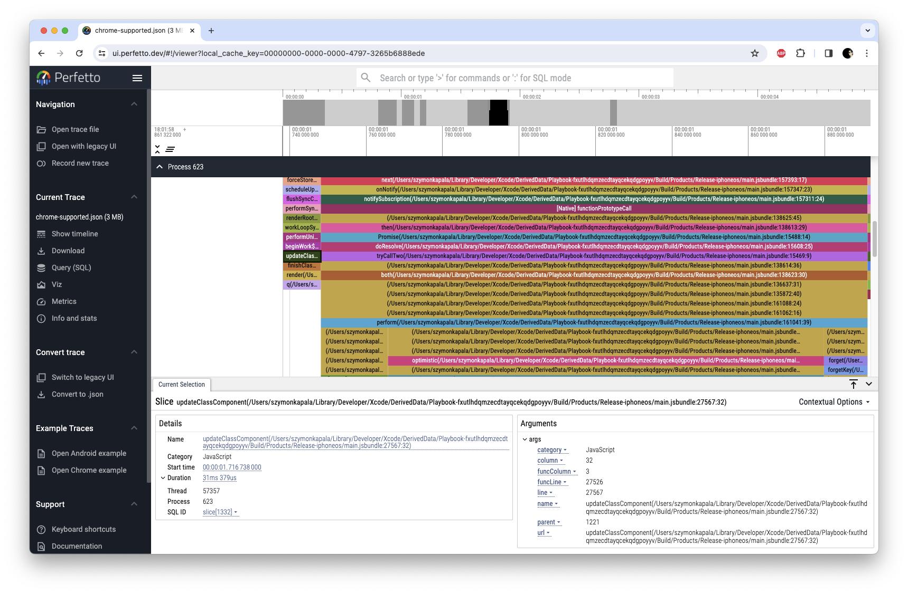

<a href="https://margelo.io">
  
</a>

# react-native-release-profiler

A fast and simple library to passively profile JS/Hermes performance in production and release builds.

## Why

Usually performance issues are profiled in debug builds, which could lead to false positives (e.g. JS Garbage Collectors, Hermes-specific debug markers, or other LLDB hangs).

**react-native-release-profiler** allows you to profile your app in release builds, both in a local environment to profile specific issues, as well as in a production environment to spot regressions or collect performance samples from a wider variety of user devices.

## Web support

The web support is based on sampling [JS Self-Profiling](https://wicg.github.io/js-self-profiling/) API, so not all browsers support it yet. To see in which browsers it is supported, check [this page](https://caniuse.com/mdn-api_profiler).

To make it possible to work you'll need to add `'Document-Policy': 'js-profiling'` header to your server response. Using `webpack` in dev mode you can do that by adding these lines to your `webpack.config.js`:

```js
devServer: {
    headers: {
        'Document-Policy': 'js-profiling',
    },
}
```

> [!WARNING]
> By default sampling interval is set to 10 milliseconds. This is the lowest supported interval, but on Windows machines this interval will be 16 milliseconds.

## Need help?

If you're having performance problems in your app, feel free to reach out to us at https://margelo.com. We do this a lot. 😉

## Installation

```sh
yarn add react-native-release-profiler
cd ios && bundle install && bundle exec pod install
```

### Expo

Expo requires you to also install @react-native-community/cli

```sh
yarn add --dev @react-native-community/cli
```

## Usage

1. Install **react-native-release-profiler**
2. Build your app in release mode
3. Start a profiling session:
    ```ts
    import { startProfiling } from 'react-native-release-profiler'

    startProfiling()
    ```
4. Stop the profiling session:
    ```ts
    import { stopProfiling } from 'react-native-release-profiler'

    // `true` to save the trace to the phone's downloads folder, `false` otherwise
    const path = await stopProfiling(true)
    ```
5. Download and process the performance trace from your phone to your PC:
    - On **Android**:
        ```
        npx react-native-release-profiler --fromDownload --appId <your appId>
        ```
    - On **iOS** and **web**:
        ```
        npx react-native-release-profiler --local <path to profile>
        ```
6. Open the performance trace in your tool of choice:
    - SpeedScope (https://www.speedscope.app)
    - Perfetto UI (https://ui.perfetto.dev/)
    - Google Chrome's Tracing UI ([chrome://tracing](chrome://tracing))




## API

### Android native + JavaScript sampling

On Android 15 (API 35) and newer, record native stacks alongside Hermes with
`startProfilingSession()`. Build against Android SDK 35 or newer and use a release
build for representative measurements. No `<profileable android:shell="true" />`
manifest entry is required for the programmatic API. System-service profiling is
enabled by default; `<profileable android:enabled="false" />` disables it.
See the [Android manifest documentation](https://developer.android.com/guide/topics/manifest/profileable-element).

```ts
import { startProfilingSession } from 'react-native-release-profiler';

const session = await startProfilingSession({
  durationMs: 30000,
  samplingFrequencyHz: 100,
});

// Exercise the app, then stop and export the capture.
const artifacts = await session.stop(true);
if (artifacts.nativeStatus !== 'success') {
  console.warn(artifacts.nativeError); // The Hermes profile is still available.
}
```

Only one recording can run at a time. The existing Hermes-only API remains
available on older Android versions and other supported platforms.

#### Capture app startup

Request native sampling just after `super.attachBaseContext(base)` before initializing
React Native. This hook does not load the Hermes profiler bridge or start JS sampling:

```kotlin
import android.content.Context
import android.os.Build
import com.releaseprofiler.NativeProfiling

override fun attachBaseContext(base: Context) {
  super.attachBaseContext(base)
  if (Build.VERSION.SDK_INT >= 35 && profilingEnabled) {
    NativeProfiling.start(this)
  }
}
```

`profilingEnabled` is your own opt-in. Keep your normal React Native/SoLoader
initialization in `onCreate()`. You can also request sampling from `onCreate()`
if the earlier hook is unnecessary.

Call `startProfilingSession()` from JS to enable Hermes sampling and adopt the
native recording, then `session.stop(true)` to export both. Native sampling is
not restarted, and the native start's options remain in effect. Without a native
startup recording, the JS call starts both collectors.

JS samples begin at the JS start call; Hermes initialization and earlier bundle
execution are not captured by the Hermes sampler. Native sampling may cover
that earlier work, but Android starts it asynchronously, so the first native
startup instructions may still be missed. Clock anchors align both recordings
in the CLI even though they start at different times.

The example startup build sleeps for 100 ms after requesting native sampling to
give it a head start. This is not a readiness guarantee and adds 100 ms to app
startup; do not treat those captures as unmodified startup-time measurements.
The library itself does not sleep.

#### Stop and merge

`startProfilingSession()` resolves when sampling is requested, not when native
sampling begins. Android starts asynchronously, may clamp settings, and applies
rate limits. `stop()` disables Hermes, requests native cancellation, and waits
for the native result. Optional `bufferSizeKb` and `resultTimeoutMs` default to
8192 KB and 120000 ms. Repeated `stop()` calls share the same result.

`stop(true)` exports `session.json`, `hermes.cpuprofile`, and, if available,
`native.perfetto-trace` into `Download/release-profiler/<sessionId>/`.
`stop()` without `true` keeps them in app-private storage. Native errors or
timeouts are reported in the artifacts; a successful Android response does not
guarantee the trace contains stack samples.

To discard a startup recording that JS will not adopt, call
`NativeProfiling.cancel(context)`.

#### Limits and caveats

- **Rate limits.** Android 15 limits stack sampling per app: after one capture,
  further requests can fail for a while with `nativeStatus: "error"` and
  `ERROR_FAILED_RATE_LIMIT_PROCESS (2)`. The Hermes profile is still exported.
  For local testing, disable the limiter on the device (and re-enable it with
  `device_config delete profiling_testing rate_limiter.disabled`):

  ```sh
  adb shell device_config put profiling_testing rate_limiter.disabled true
  ```

- **Clamped frequency.** Android may lower `samplingFrequencyHz` (for example,
  1000 Hz runs at 200 Hz) and the kernel can drop records at high rates. The CLI
  prints the effective native frequency and any lost records. Hermes samples at
  its own fixed rate (~100 Hz) regardless of this option.
- **Inlined functions.** Hermes may inline small functions into their caller;
  their time then appears under the caller in the Hermes track.
- **Native symbols.** Release builds ship stripped `.so` files, so frames inside
  `libhermesvm.so` and other app libraries are unnamed unless you symbolize the
  trace with the unstripped libraries from your build.

### Pull and merge native and Hermes profiles

Finish the recording with `await session.stop(true)` to export both profiles
and their synchronization metadata. `pull-merge` automatically selects the
latest exported session by its `session.json` modification time, keeping native
and Hermes profiles from the same session together.

Connect the Android device with USB debugging enabled and `adb` available on
your PATH. Run `pull-merge` with the **composed Hermes source map from the exact
installed release build**:

```sh
npx react-native-release-profiler pull-merge \
  --directory ./captures \
  --sourcemap-path ./android/app/build/generated/sourcemaps/react/release/index.android.bundle.map \
  --output ./merged.trace
```

Use `--device <adb-serial>` when multiple devices are connected. The originals
are retained in `./captures/<sessionId>/`, including when merging fails. Repeated
pulls use a unique directory suffix to preserve previous downloads. To select
an older capture, pass its ID: `pull-merge <sessionId>`. For files already
on disk, use `--merge-session <path/to/session.json>` instead.

The CLI automatically converts the merged samples to Simpleperf format. In
Android Studio, choose **Profiler → Past Recordings → Import recording** and
select `merged.trace` to open it as **Callstack Sample**.

To export for Perfetto instead, add `--format perfetto` and omit `--output`
(or set `--output ./merged.perfetto-trace`). In
[Perfetto](https://ui.perfetto.dev/), choose **Open trace file** and select
`merged.perfetto-trace`. Find the app process and its JS thread to compare native
stacks with the `Hermes wall-clock samples (not CPU time)` sampling session.

The Perfetto export preserves native
trace packets and adds symbolicated Hermes samples on the same timeline.
Start/stop clock anchors map Hermes' monotonic timestamps to Android's boottime
clock. Captures with clock changes (such as device suspend), mismatched process
IDs, missing native samples, or invalid timestamp coverage are rejected.
Native and JS stacks remain independent samples; they are not joined into one
call stack or converted into exact function durations.


### Open a merged sampling profile in Android Studio

Simpleperf is the default output format, so no format flag is needed:

```sh
npx react-native-release-profiler pull-merge \
  --sourcemap-path ./android/app/build/generated/sourcemaps/react/release/index.android.bundle.map \
  --output ./merged.trace
```

In Android Studio, open **Profiler → Past Recordings → Import recording** and
select `merged.trace`. Use
`--merge-session ./captures/<sessionId>/session.json` to convert a session already
on disk. Without `--output`, the default Simpleperf export uses `merged.trace`;
`--format perfetto` uses `merged.perfetto-trace`.

This exports sampled stacks, timestamps, and process IDs, including symbolicated
JS frames. Android Studio shows **JS thread (native sampling)** separately from
**Hermes profiler**. Native samples retain their real thread IDs; Hermes samples
use collision-free synthetic track IDs because Studio groups samples by thread.
The Hermes track label includes the original JS thread ID. These are two views
of the same runtime thread, not two actual operating-system threads. Native and Hermes samples remain independent stacks;
they are not stitched together. The report labels native and Hermes wall-clock
samples as separate event types, with a weight of one per sample. Sampling rates
and meanings differ, so combined counts and Studio's inferred flame-chart widths
are not CPU-time measurements. The CPU usage chart is unavailable because no
CPU utilization data is captured. Non-sampling Perfetto packets are omitted;
keep the Perfetto export for the full trace. This is the Simpleperf **report**
format, not a raw `perf.data` recording.

### Analyze with AI agents and scripts

The CLI can summarize a capture instead of opening it in a GUI. Every command accepts
`--json` and then prints exactly one JSON object (`{"ok": true, "result": …}` or
`{"ok": false, "error": {"code": "E_…", "message": …}}`).

```sh
# Environment check: device, Android version, rate limiter, sessions, source map match
npx react-native-release-profiler doctor --appId com.example --sourcemap-path <map>

# Hotspots with source lines, long JS tasks, native breakdown, capture-quality warnings
npx react-native-release-profiler analyze --pull --appId com.example \
  --sourcemap-path <map> --output before.json

# After a fix: same scenario, new build and map, then compare (marks sampling noise)
npx react-native-release-profiler analyze --pull --appId com.example \
  --sourcemap-path <new map> --output after.json
npx react-native-release-profiler compare before.json after.json
```

`analyze` also accepts a session directory or `--profile <file.cpuprofile>` for JS-only
captures, and `pull-merge --format folded` writes collapsed stacks for grep or flame graphs.

An agent skill describing the full profile → fix → verify workflow ships with the package.
Copy it into your agent's skills directory, for example:

```sh
npx react-native-release-profiler install-skill .claude/skills
```

### `startProfiling(): void`

Synchronously starts the Hermes Profiling Session.

### `stopProfiling(saveInDownloadsDirectory?: boolean, fileName?: string): Promise<string>`

Asynchronously stops the Hermes Profiling Session, and saves the file in a cache or downloads directory if `saveInDownloadsDirectory` is `true` using the provided `fileName` (web only).

Returns the path of the saved profile.

## Contributing

See the [contributing guide](CONTRIBUTING.md) to learn how to contribute to the repository and the development workflow.

## License

MIT
